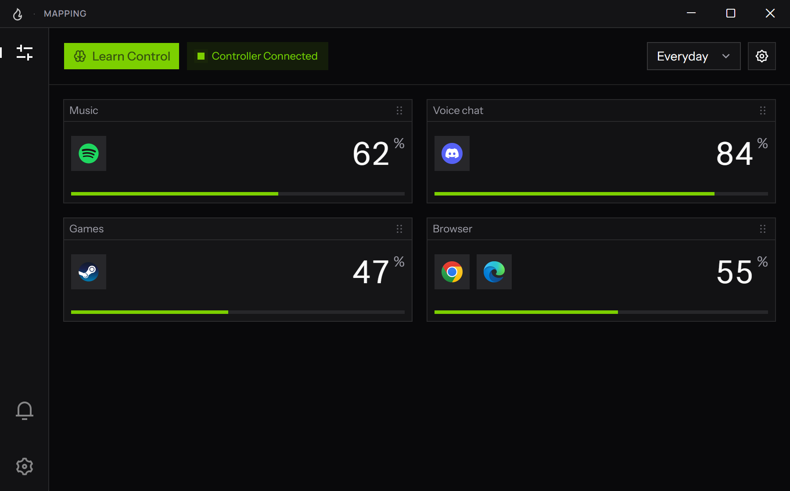
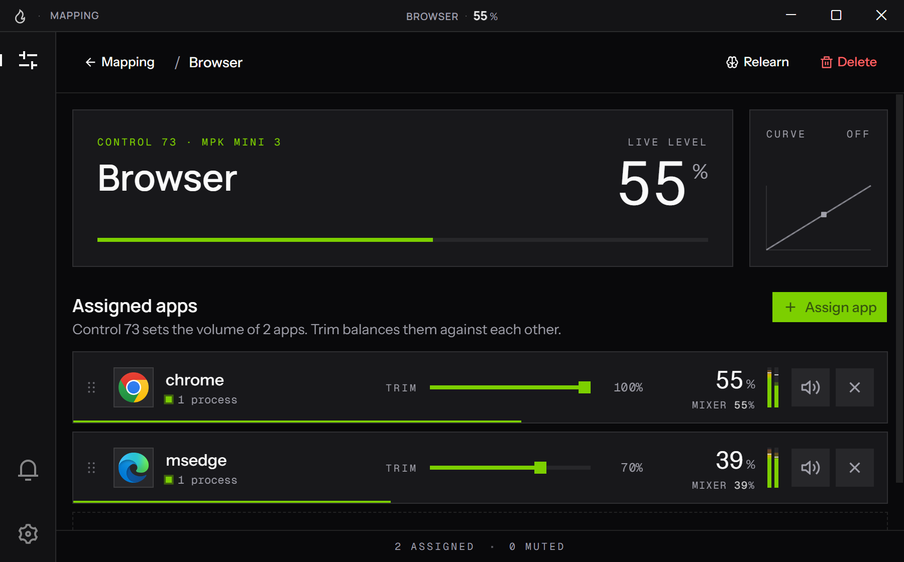

<div align="center">


# Volcon

**Turn a MIDI controller into a volume mixer for Windows.**

Put your music on one fader, voice chat on the next and your game on a knob.<br />
Each control sets the volume of the apps you give it, the moment you move it.

[](https://github.com/logie-labs/volcon-client/releases/latest)
[](https://github.com/logie-labs/volcon-client/actions/workflows/ci.yml)
[](#requirements)
[](LICENSE)

[**Download for Windows**](https://github.com/logie-labs/volcon-client/releases/latest) · [Report a problem](https://github.com/logie-labs/volcon-client/issues/new?template=bug_report.yml) · [What's new](CHANGELOG.md)

</div>

<p align="center">
  
</p>

## Features

**Made for the controller you have**

- Works with MIDI controllers Windows recognises: any knob or fader that sends control changes.
- Learn a control by moving it. There are no MIDI numbers to look up.
- Give a control as many apps as you like, with trim to balance them against each other and a mute for each.
- Keep whole setups as presets, one for gaming and one for streaming, each with its own controller.
- A logarithmic response gives more of a fader's travel to the quiet end, where loudness changes most. A deadzone ignores a worn knob's jitter while you're not touching it.

**Always know where you are**

- An on-screen overlay shows the level as you move a control.
- Live level meters for every app, and the level of the mapping you're on in the title bar.
- Notifications say what happened in plain words, like a controller unplugging or an app being handed back to Windows. Changes can be undone from them.

**Out of the way**

- Starts with Windows, straight into the tray if you like, and closing the window keeps it running there.
- A command menu, on <kbd>Ctrl</kbd> + <kbd>Alt</kbd>, gets you anywhere and does most things from the keyboard.
- Light and dark themes, or whichever Windows is using.
- Back up your settings to a file and bring them back on another PC.
- Updates itself: download a new version in the app and it installs quietly, now or the next time Volcon starts.

<p align="center">
  
  <br />
  <sub>A mapping's own screen: one knob for two browsers, balanced with trim.</sub>
</p>

## Download

Download `Volcon_x.y.z_x64-setup.exe` from the [latest release](https://github.com/logie-labs/volcon-client/releases/latest) and run it. It installs for your Windows account only, so it doesn't need administrator rights.

When there's a new version, Volcon says so in its title bar. Download it there or on **Settings → Updates**, and it installs itself: straight away, as Volcon closes for a moment and opens again, or the next time Volcon starts. Your presets and settings carry over.

> [!NOTE]
> The installer isn't code-signed yet, so Windows SmartScreen may say *Windows protected your PC*. Choose **More info**, then **Run anyway**. Every installer is built from this repository's code by [GitHub Actions](https://github.com/logie-labs/volcon-client/actions/workflows/release.yml), where you can see exactly how.

### Requirements

- Windows 10 or 11, 64-bit.
- A MIDI controller with knobs or faders. Most USB controllers work without installing a driver.
- WebView2, which comes with Windows 11. On Windows 10, the installer adds it if it's missing.

## Getting started

1. Plug in your controller and open Volcon.
2. On **Mapping**, create a preset, then choose your controller in its settings.
3. Choose **Learn a Control…** and move the knob or fader you want to use.
4. Add the apps it should control.
5. Move the control. The overlay shows the level as it changes.

Right-click anything for more. **Settings → About → Show shortcuts** lists every shortcut.

## Questions

<details>
<summary><b>Volcon says my controller is "In Use Elsewhere"</b></summary>
<br />

Windows can let only one app use a MIDI controller at a time. Close whatever else has it open, like a music app or the maker's editor, and Volcon picks it up.

</details>

<details>
<summary><b>Is this the same volume as Windows' volume mixer?</b></summary>
<br />

Yes. Volcon moves the same per-app volume you see in Windows' volume mixer, so the two always agree.

</details>

<details>
<summary><b>Where are Volcon's logs?</b></summary>
<br />

**Settings → Diagnostics → Log files** opens the folder. To report a problem, use **Settings → About → Report a problem** instead: it starts a bug report with your versions and controllers already filled in.

</details>

## Privacy

Volcon has no account, no analytics and no telemetry. Your presets and settings stay on your PC.

It only goes online for updates. It checks GitHub's list of releases for a newer version when Volcon starts, at most once a day, which you can turn off in **Settings → Updates**. And it downloads a new version's installer from GitHub when you ask it to.

## Building from source

You'll need Windows 10 or 11 with:

- [Node.js](https://nodejs.org) 20.9 or newer.
- [Rust](https://rustup.rs).
- The [Microsoft C++ Build Tools](https://visualstudio.microsoft.com/visual-cpp-build-tools/).

Tauri's [prerequisites guide](https://v2.tauri.app/start/prerequisites/) covers each of these.

```sh
git clone https://github.com/logie-labs/volcon-client.git
cd volcon-client
npm install
npm run dev            # the app, reloading as you edit
npm run tauri build    # the installer, in src-tauri/target/release/bundle/nsis
```

[CONTRIBUTING.md](CONTRIBUTING.md) has the checks to run before a pull request.

### How it works

Volcon is a [Tauri](https://tauri.app) app. Its Rust backend:

- reads the controller with [midir](https://github.com/Boddlnagg/midir);
- turns each control's position into a level, through the curve and the deadzone;
- sets each app's volume through Windows' audio session API, using [windows-rs](https://github.com/microsoft/windows-rs).

The interface is a [Next.js](https://nextjs.org) app, exported as static files and shown in WebView2.

```text
app/                    The main window, and the overlay's own page
components/sections/    The screens: Mapping, Notifications and Settings
components/ui/          Shared building blocks, from shadcn/ui on Base UI
context/  lib/          State shared between screens, and the bridge to the backend
src-tauri/src/
  config.rs             Presets and mappings, saved to disk
  tray.rs               The tray icon and its menu
  server/midi/          Controllers and the messages they send
  server/input/         Control messages into changes, past the deadzone
  server/state/         Levels with the curve, trim and mute, and the meters
  server/audio/         Windows' audio sessions: setting volumes, reading levels
  server/overlay.rs     Placing the overlay window
```

## Credits

Volcon is built with [Tauri](https://tauri.app), [React](https://react.dev), [Next.js](https://nextjs.org), [Base UI](https://base-ui.com), [shadcn/ui](https://ui.shadcn.com), [Tailwind CSS](https://tailwindcss.com), [Motion](https://motion.dev), [midir](https://github.com/Boddlnagg/midir) and [windows-rs](https://github.com/microsoft/windows-rs). **Settings → About → Credits** in the app has the full list, with licences.

## Licence

Volcon is released under the [MIT Licence](LICENSE).

A few interface components are adapted from other projects and keep their own licences:

- shadcn/ui, Motion Primitives and Magic UI, under MIT;
- React Bits, under MIT with the Commons Clause.
